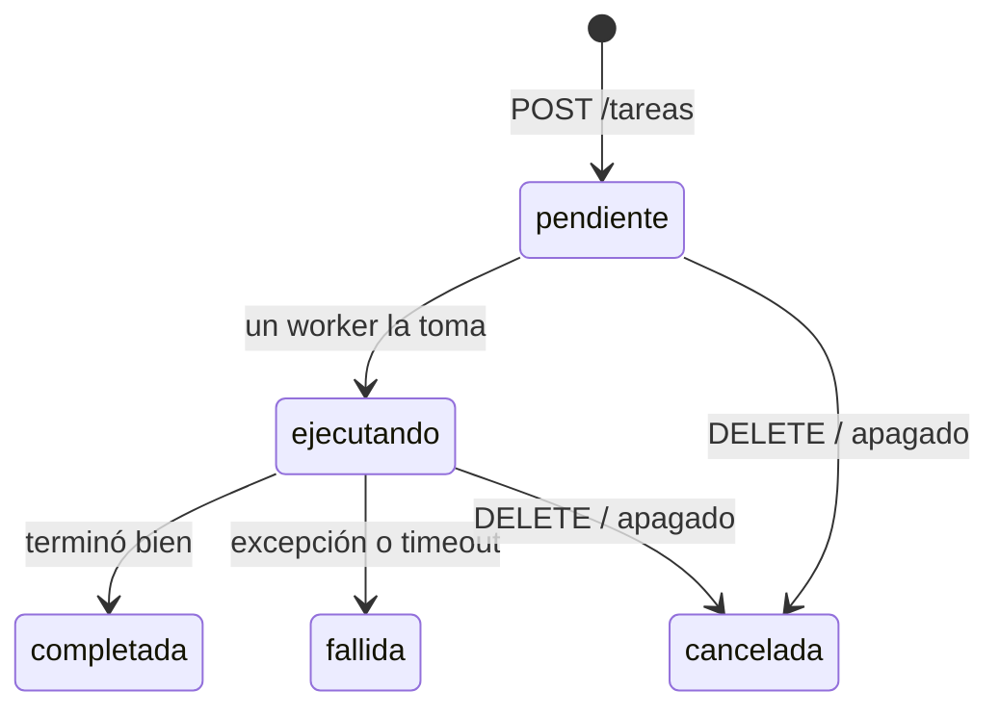

# TP2 — Plataforma de Tareas Distribuidas

**Computación II — Universidad de Mendoza — 2026**
Alumno: _(tu nombre y legajo)_

Un servicio HTTP al que se le encargan trabajos, que los ejecuta de forma concurrente
y permite consultar su estado y resultado. Está hecho con **FastAPI**, una
**`asyncio.Queue`**, un **pool de workers** (corrutinas) y un **`ProcessPoolExecutor`**
para el trabajo de CPU.

## Índice

1. [Descripción y uso](#1-descripción-y-uso)
2. [Arquitectura](#2-arquitectura)
3. [Decisiones de diseño](#3-decisiones-de-diseño)
4. [Mediciones](#4-mediciones)
5. [Conceptos del curso aplicados](#5-conceptos-del-curso-aplicados)
6. [Limitaciones conocidas](#6-limitaciones-conocidas)
7. [Lo que aprendí](#7-lo-que-aprendí)
8. [Bonus implementados](#8-bonus-implementados)
9. [Estructura del repositorio](#9-estructura-del-repositorio)

---

## 1. Descripción y uso

### Qué hace

Se le pide una tarea por `POST /tareas`, responde **al instante** con un `id`, y la
tarea se ejecuta en segundo plano. Después se consulta con `GET /tareas/{id}`.

| Tipo | Naturaleza | Qué hace |
|------|-----------|----------|
| `descargar` | I/O-bound | Baja una lista de URLs **concurrentemente**; por cada una devuelve código HTTP, bytes y segundos |
| `hashear` | CPU-bound | Aplica SHA-256 N veces a un texto, **en otro proceso** para no bloquear el event loop |
| `esperar` | I/O simulado | Duerme N segundos (para probar cancelación, timeouts y ver estados en vivo) |

Estados: `pendiente` → `ejecutando` → `completada` | `fallida` | `cancelada`.



### Levantarlo

```bash
docker compose up --build
```

Eso levanta dos servicios:

- `api` en **http://localhost:8000** (documentación interactiva en **http://localhost:8000/docs**)
- `lento` en **http://localhost:9000**: un servidor de prueba que tarda lo que uno le pide
  en responder. Sirve para que las mediciones de descargas sean reproducibles sin
  depender de internet.

Para apagarlo ordenadamente: `Ctrl+C` o `docker compose stop` (manda `SIGTERM`). El
estado queda en `./volcados/estado_<timestamp>.json`.

**Sin Docker** (Python 3.11+):

```bash
python -m venv venv && source venv/bin/activate
pip install -r requirements-dev.txt
python -m lento.servidor &        # servidor de prueba en :9000
python -m app.main                # API en :8000
```

### Configuración (variables de entorno, en `docker-compose.yml`)

| Variable | Default | Qué controla |
|----------|---------|--------------|
| `WORKERS` | 4 | Corrutinas worker que consumen de la cola |
| `PROCESOS_CPU` | núcleos | Procesos del `ProcessPoolExecutor` |
| `COLA_MAX` | 1000 | Tamaño máximo de la cola (backpressure) |
| `TIMEOUT_DEFECTO` | 60 | Timeout por tarea si el cliente no manda uno (s) |
| `GRACIA_APAGADO` | 10 | Cuánto se espera a las tareas en curso al apagar (s) |
| `HASH_BLOQUE` | 100000 | Iteraciones por bloque mandado al executor |
| `DESCARGAS_SIMULTANEAS` | 20 | Descargas a la vez dentro de una tarea |

### Ejemplos con `curl`

```bash
# Encolar una de cada tipo (responde 202 Accepted al instante, con el id)
curl -s -X POST localhost:8000/tareas -H 'Content-Type: application/json' \
     -d '{"tipo": "esperar", "parametros": {"segundos": 30}}'

curl -s -X POST localhost:8000/tareas -H 'Content-Type: application/json' \
     -d '{"tipo": "hashear", "parametros": {"texto": "hola", "iteraciones": 5000000}}'

curl -s -X POST localhost:8000/tareas -H 'Content-Type: application/json' \
     -d '{"tipo": "descargar", "parametros": {"urls": [
            "http://lento:9000/bytes/100000?demora=1",
            "http://lento:9000/bytes/5000?demora=0.5",
            "https://www.python.org"]}}'

# Con timeout propio (pasa a "fallida" a los 2 s)
curl -s -X POST localhost:8000/tareas -H 'Content-Type: application/json' \
     -d '{"tipo": "esperar", "parametros": {"segundos": 10}, "timeout": 2}'

# Consultar
curl -s localhost:8000/tareas/1
curl -s 'localhost:8000/tareas?estado=ejecutando'
curl -s localhost:8000/estadisticas

# Cancelar (pendiente o en ejecución)
curl -s -X DELETE localhost:8000/tareas/1

# Bonus
curl -s localhost:8000/metrics                   # formato Prometheus
websocat ws://localhost:8000/eventos             # o cualquier cliente WebSocket
```

> Ojo con las URLs de `descargar`: las baja **el contenedor `api`**, así que el servidor
> de prueba se llama `http://lento:9000` (el nombre del servicio en la red de Docker),
> no `localhost:9000`. Si corrés sin Docker, usá `localhost:9000`.

### Endpoints

| Método | Ruta | Respuestas |
|--------|------|-----------|
| `POST` | `/tareas` | `202` encolada · `422` cuerpo inválido · `503` cola llena o apagándose |
| `GET` | `/tareas?estado=&limite=&id_desde=` | `200` lista (filtro y paginación opcionales) |
| `GET` | `/tareas/{id}` | `200` · `404` |
| `DELETE` | `/tareas/{id}` | `200` con el estado final · `404` · `409` si ya había terminado |
| `GET` | `/estadisticas` | Totales por estado, duración promedio (total y por tipo), espera en cola promedio, workers ocupados/total, tamaño de cola |
| `GET` | `/metrics` | Lo mismo en formato Prometheus (bonus) |
| `WS` | `/eventos` | Un JSON por cada cambio de estado (bonus) |

### Tests

```bash
pip install -r requirements-dev.txt
pytest -v
```

14 tests con `pytest-asyncio` (bonus): que el POST no espere, las tres tareas, la
concurrencia de descargas, cancelación de pendientes y en ejecución (incluida a
mitad de descarga y a mitad de hash), timeouts, excepciones, cola llena, que el hash
no bloquee la API, y el apagado con volcado. Pasan en Python 3.11, 3.12 y 3.13.

---

## 2. Arquitectura

```
                 ┌──────────────────────── proceso principal (1 thread, 1 event loop) ───────────────────────┐
                 │                                                                                           │
  Cliente ──HTTP─┼─> uvicorn ──> FastAPI (main.py)                                                           │
  (curl)         │                 │  POST /tareas ──(1) registro.crear()──> Registro (dict en memoria)       │
                 │                 │                └─(2) cola.put_nowait(id)                                 │
                 │                 │  GET  /tareas ───── lee ──────────────> Registro                         │
                 │                 │  DELETE /tareas/id ─ ejecución.cancel()                                  │
                 │                 │                                                                          │
                 │                 v                                                                          │
                 │        ┌─────────────────┐  (3) get()   ┌──────────────────────────┐                       │
                 │        │  asyncio.Queue  │ ───────────> │  N workers (corrutinas)  │                       │
                 │        │  maxsize=1000   │              │  motor.py                │                       │
                 │        └─────────────────┘              └────────────┬─────────────┘                       │
                 │                                                      │ (4) create_task(ejecución)          │
                 │                                                      │     con asyncio.timeout()           │
                 │                       ┌──────────────────────────────┼─────────────────────────┐           │
                 │                       v                              v                         v           │
                 │              descargar.py                    esperar.py                hashear.py          │
                 │          TaskGroup + Semaphore             asyncio.sleep          run_in_executor ──────────┼──┐
                 │          httpx.AsyncClient (compartido)                            (bloques de 100k)        │  │
                 └──────────────────┬─────────────────────────────────────────────────────────────────────────┘  │
                                    │ red (sockets no bloqueantes, epoll)                                        │
                                    v                                                                            v
                        Internet / servicio `lento`                                   ┌──── ProcessPoolExecutor ────┐
                                                                                      │ proceso 1 │ ... │ proceso P │
                                                                                      │ (su GIL)  │     │ (su GIL)  │
                                                                                      └─────────────────────────────┘
```

### El recorrido de una tarea

1. `POST /tareas` llega a FastAPI. Pydantic valida el cuerpo (si falta `texto` para
   `hashear`, responde `422` sin tocar nuestro código).
2. `Motor.encolar()` crea la tarea en el `Registro` (estado `pendiente`) y pone su
   **id** en la cola con `put_nowait`. El endpoint devuelve `202` con el id. Tiempo
   total: milisegundos, sin importar cuánto dure la tarea.
3. Un worker libre, que estaba suspendido en `await cola.get()`, se despierta con el id.
   Si la tarea ya no está `pendiente` (la cancelaron mientras esperaba), la saltea.
4. El worker la pasa a `ejecutando` y crea una **`asyncio.Task` hija**, la "ejecución",
   que corre la función del tipo de tarea dentro de `asyncio.timeout(t.timeout)`. El
   worker hace `await` de esa ejecución.
5. Según cómo termina la ejecución, el worker pone el estado final:
   resultado → `completada`; `TimeoutError` → `fallida` ("timeout: superó los X s");
   cualquier otra excepción → `fallida` con el mensaje; `CancelledError` → `cancelada`.
6. `cola.task_done()` en un `finally`, y el worker vuelve a `cola.get()`.

### Módulos

| Archivo | Responsabilidad |
|---------|-----------------|
| `app/main.py` | App FastAPI, endpoints, `lifespan` (arranque y apagado), WebSocket, métricas |
| `app/motor.py` | La cola, los workers, la supervisión, la cancelación y el apagado ordenado |
| `app/registro.py` | El estado: dict de tareas, transiciones de estado y estadísticas |
| `app/modelos.py` | Modelos Pydantic (unión discriminada por `tipo`) y los estados |
| `app/tareas/*.py` | Un módulo por tipo de tarea, todos con la firma `async def ejecutar(params, ctx)` |
| `app/persistencia.py` | Volcado atómico a JSON y lectura del último volcado |
| `app/eventos.py` | Difusión de eventos a los clientes WebSocket |
| `app/config.py` | Configuración por variables de entorno |
| `lento/servidor.py` | Servidor de prueba con demoras controladas |
| `mediciones/*.py` | Los scripts de las tres mediciones |

---

## 3. Decisiones de diseño

### ¿Por qué `asyncio.Queue` y no `queue.Queue`?

Porque todo el servidor corre en **un solo thread**: el del event loop.
`queue.Queue.get()` es una llamada **bloqueante**: si la cola está vacía, frena el
thread hasta que llegue algo. Como el thread es uno solo, frenaría al event loop
entero: ni los otros workers ni la API podrían hacer nada, y como el que tiene que
poner algo en la cola (el endpoint POST) corre en ese mismo thread, nunca llegaría
nada. Deadlock.

`asyncio.Queue.get()` es una **corrutina**: si la cola está vacía, *suspende* al
worker (le devuelve el control al loop) y el loop sigue atendiendo pedidos. Cuando
el POST hace `put`, el loop despierta a un worker. `queue.Queue` está pensada para
sincronizar **threads** (por eso tiene un lock adentro); `asyncio.Queue` para
**corrutinas** del mismo loop, y no necesita lock (ver abajo).

Además usamos `put_nowait` en el POST y no `await put()`: si la cola está llena,
preferimos responder `503 Service Unavailable` con `Retry-After` a dejar al cliente
colgado esperando lugar. Ese es el **backpressure**: `maxsize` impide que la cola crezca
sin límite y se coma la memoria (ver medición 3C).

### ¿Por qué el pool de workers no necesita un `Lock`?

En asyncio solo hay cambio de corrutina en un `await`. Entre dos `await` el código
corre de punta a punta sin que nadie lo interrumpa. Todos los métodos del `Registro`
(`crear`, `iniciar`, `terminar`...) son funciones comunes, sin ningún `await` adentro,
así que cada transición de estado es atómica respecto de las demás corrutinas.
Y el código que corre en *otros* threads o procesos (el hash) nunca toca el registro:
recibe bytes y devuelve bytes.

Donde sí hay que pensar es en lo que pasa **a través** de un `await`. Ejemplo: en
`_procesar`, entre que el worker saca el id de la cola y lo ejecuta, alguien pudo
haberla cancelado. Por eso, apenas la saca, chequea que siga `pendiente`.

### ¿Cómo evito que una tarea CPU-bound congele la API?

Un `for` de millones de SHA-256 no tiene ningún `await`: si corre en una corrutina,
el loop no recupera el control hasta que termina. La medición 2 lo muestra: un
`GET /tareas` tardó **3,5 segundos** en responder.

La solución es `loop.run_in_executor(pool_cpu, hash_iterado, h, n)`: el cálculo corre
en un proceso del `ProcessPoolExecutor` y la corrutina hace `await` del resultado,
cediendo el control mientras tanto. Con eso, el mismo GET tarda **3,5 ms**.

- **Procesos y no threads**, por el GIL: un thread que calcula no deja correr bytecode
  a los demás. Con `asyncio.to_thread` el loop sigue vivo pero compite por el GIL (el
  GET tarda 14 ms, 4× más que con procesos), y dos hashes en threads no corren en
  paralelo. Cada proceso tiene su propio intérprete y su GIL.
- **El pool se crea una sola vez** al arrancar (en el `lifespan`), y se precalienta.
  Crear procesos es caro.
- **`spawn` explícito** (`mp_context`): mismo comportamiento en Linux, macOS y Windows.
  Por eso el arranque está protegido con `if __name__ == '__main__':`, porque con
  `spawn` cada proceso hijo re-importa el módulo principal.
- **La función es de módulo** (`hash_iterado`), porque lo que se manda a otro proceso
  viaja pickleado, y las lambdas y funciones anidadas no se pueden picklear.
- **En bloques de 100.000 iteraciones** (~0,1 s). Entre bloque y bloque hay un
  `await`, y eso es lo que permite cancelar y cortar por timeout un hash en curso, y
  reportar el `progreso`. Un `Future` de un executor no se puede cancelar una vez que
  arrancó (clase 22), así que sin bloques un hash de un minuto no se podría cancelar.
  El costo medido es chico (ver extra en mediciones).

También revisé todo el código buscando **otras** cosas que bloqueen el loop:

| Posible bloqueo | Cómo se evita |
|---|---|
| Descargas con `requests` | `httpx.AsyncClient` |
| `time.sleep` | No aparece en ninguna corrutina; `esperar` usa `asyncio.sleep` |
| Escribir el volcado JSON (I/O de disco) | `asyncio.to_thread(persistencia.volcar, ...)` |
| Leer el volcado previo al arrancar | `asyncio.to_thread(...)` |
| `pool.shutdown(wait=True)` al apagar | `asyncio.to_thread(...)` |
| Resolución DNS (`getaddrinfo` es bloqueante en el SO) | httpx/anyio usan `loop.getaddrinfo`, que la corre en un thread |

El único bloqueo que queda es **a propósito**: `hashear` con `"modo": "directo"`,
que existe solo para la medición 2.

### ¿Cómo implementé la cancelación, y qué pasa con los recursos a medio usar?

El worker no ejecuta la tarea directamente: crea una **`asyncio.Task` hija** (la
ejecución), la guarda en `motor.en_curso[id]` y la espera. Así `DELETE` puede
cancelar *esa* ejecución sin matar al worker, que sigue con la próxima tarea.

- **Tarea pendiente**: se marca `cancelada`. Su id sigue en la cola, pero cuando un
  worker lo saque va a ver que no está `pendiente` y lo salteará.
- **Tarea en ejecución**: `ejecucion.cancel()` inyecta un `CancelledError` en el
  `await` donde esté parada. El `DELETE` espera hasta 2 s con `asyncio.wait` (que no
  cancela nada si vence; solo deja de esperar) y devuelve el estado ya `cancelada`.
  En las pruebas tarda unos 50 ms.

Qué pasa con los recursos en cada tipo:

- **`descargar` a mitad de descarga**: las descargas son hijas de un `TaskGroup`. Al
  cancelar, el TaskGroup cancela a todas las hijas **y espera a que terminen** (no
  quedan huérfanas, a diferencia de `gather`). Cada descarga está dentro de
  `async with semaforo:` y `async with cliente.stream(...)`: al salir por la
  excepción, el semáforo se libera y la respuesta HTTP se cierra (la conexión se
  descarta o vuelve al pool). El cuerpo se lee por pedazos, así que no queda un
  buffer gigante a medio llenar. Hay un test que verifica que las 5 corrutinas hijas
  desaparecen después del DELETE.
- **`hashear`**: el `CancelledError` entra en el `await` del bloque. El bloque que ya
  estaba corriendo en el otro proceso **no se puede interrumpir** (no hay forma segura
  de matar código a mitad de cálculo): termina, a lo sumo ~0,1 s después, y su
  resultado se descarta. El proceso queda libre para la próxima tarea.
- **`esperar`**: `asyncio.sleep` se cancela inmediatamente.

**La regla que seguí**: nunca tragarse un `CancelledError`. Donde se captura
(`descargar.py`), se relanza. En `motor._procesar` hay que distinguir **a quién**
cancelaron: si fue un DELETE, la ejecución está cancelada pero el worker no, y tiene
que seguir; si fue el apagado, cancelaron al **worker**, y tiene que terminar. Eso se
distingue con `asyncio.current_task().cancelling()` (Python 3.11+), que cuenta los
pedidos de cancelación pendientes sobre la tarea actual.

**Timeouts**: `asyncio.timeout(t.timeout)` alrededor de la ejecución. Cuando vence,
cancela la ejecución (con la misma limpieza que un DELETE) y convierte ese
`CancelledError` en `TimeoutError`, que el worker traduce a `fallida`.

### ¿Qué pasa si un worker lanza una excepción no capturada?

Hay tres niveles de defensa:

1. **Excepción de la tarea** (una URL inválida en todas, un bug en un tipo de tarea):
   la captura `_procesar` y la tarea pasa a `fallida` con
   `"error": "TipoDeExcepcion: mensaje"`. El worker sigue vivo. Hay un test que mete
   una tarea que lanza `ValueError` y verifica que los workers siguen corriendo.
2. **Excepción en nuestro propio código del worker** (fuera de la tarea): el
   `while True` del worker tiene un `except Exception` que la loguea con el
   traceback completo y sigue con la próxima. `task_done()` está en un `finally`,
   así que la cola nunca queda desbalanceada (si no, un `join()` esperaría para siempre).
3. **Si aun así un worker muere**: cada worker tiene un `add_done_callback` que actúa
   de supervisor. Si el worker terminó con una excepción y no estamos apagando, lo
   loguea y **lanza un reemplazo**.

Sin esto pasaría lo de la clase 22, "el bug silencioso": una excepción en una
`asyncio.Task` que nadie espera no se ve en ningún lado, el worker desaparece y el pool
se va achicando hasta quedar en cero, con tareas pendientes que nunca se ejecutan.

### Apagado ordenado (SIGTERM / SIGINT) y persistencia

La cadena completa:

1. `docker compose stop` le manda `SIGTERM` al PID 1 del contenedor. El `CMD` del
   Dockerfile está en forma *exec* (`["python", "-m", "app.main"]`) para que el PID 1
   sea Python y no un `/bin/sh` que no reenvía la señal. `Ctrl+C` manda `SIGINT`.
2. **uvicorn** tiene instalados los handlers de esas dos señales (con `signal.signal`,
   a propósito, incluso donde existe `loop.add_signal_handler`). El handler solo
   prende un flag (`should_exit`) que el bucle principal de uvicorn consulta cada
   0,1 s: es el patrón "flag que el loop consulta" de la clase 6 (y el que la consigna
   sugiere para Windows), así que funciona en cualquier plataforma. Un segundo `Ctrl+C`
   fuerza la salida sin esperar. No instalé handlers propios con `add_signal_handler`
   porque pisarían los de uvicorn y él nunca se enteraría de que tiene que cerrar.
3. uvicorn **cierra el socket que escucha**: no entran conexiones nuevas. Espera a que
   terminen los pedidos en curso (como mucho 5 s, `timeout_graceful_shutdown`) y
   ejecuta la parte de apagado del `lifespan`.
4. `Motor.apagar()`:
   1. `aceptando = False`: si se colara un POST, recibe `503`.
   2. Vacía la cola: lo que nunca arrancó queda `cancelada` con
      `"no llegó a ejecutarse: apagado del servidor"`.
   3. Espera a las tareas en ejecución **como mucho `GRACIA_APAGADO` segundos** con
      `asyncio.wait(..., timeout=...)`.
   4. Las que no terminaron, se cancelan (`"cancelada por apagado del servidor"`) y se
      espera a que limpien.
   5. Cancela los workers (están parados en `cola.get()`) y espera a que salgan.
5. Vuelca todo a `volcados/estado_<timestamp>.json`: estadísticas y todas las tareas
   con sus resultados. La escritura es **atómica** (archivo temporal + `os.replace`), así
   que nunca queda un JSON cortado por la mitad, y va a un thread para no bloquear el loop.
6. Cierra el cliente HTTP y apaga el pool de procesos.

`stop_grace_period: 30s` en el compose: Docker espera eso antes de mandar `SIGKILL`.
Tiene que ser mayor que `GRACIA_APAGADO` + el tiempo del volcado.

Al arrancar, si hay un volcado previo, se reporta por log:

```
INFO app: volcado previo encontrado: volcados/estado_20261029_172612.json (2026-10-29T17:26:12,
          15101 tareas, por estado: {'pendiente': 0, 'ejecutando': 0, 'completada': 15101,
          'fallida': 0, 'cancelada': 0})
```

**Un bug que encontré probando esto**: con un cliente conectado al WebSocket
`/eventos`, el apagado **se colgaba**. El endpoint estaba parado en `await cola.get()`
esperando eventos, nunca se enteraba de que uvicorn había cerrado la conexión, y
uvicorn lo esperaba indefinidamente: el volcado no se hacía y Docker habría terminado
con `SIGKILL`. Lo arreglé con dos corrutinas por cliente (una manda eventos, otra
escucha el cierre) y `asyncio.wait(FIRST_COMPLETED)`, más el `timeout_graceful_shutdown`
de uvicorn como red de seguridad.

### Otras decisiones

- **httpx y no aiohttp**: la API es casi igual a la de `requests`, es la que usamos en
  las clases 19 y 20, tiene timeouts por fase y límites de conexiones configurables, y
  el mismo cliente sirve para los tests (`ASGITransport`). Un **único** `AsyncClient`
  compartido reusa conexiones con keep-alive en vez de abrir una por pedido.
- **Una URL que falla no hace fallar a la tarea**: el error queda en el resultado de
  esa URL (`"error": "ConnectError: ..."`). Si fallan **todas**, la tarea es `fallida`.
  Un 404 no es un error de descarga: se descargó y el código está en `estado_http`.
- **Tope de bytes por URL** (`MAX_BYTES_DESCARGA`, 50 MB) para que una URL enorme no
  llene la memoria.
- **`202 Accepted` y no `201 Created`** en el POST: 202 significa "lo recibí y lo voy a
  procesar", que es exactamente lo que pasa. Se agrega el header `Location: /tareas/{id}`.
- **`409 Conflict`** al cancelar una tarea que ya terminó.
- **Unión discriminada de Pydantic** para el cuerpo: según `tipo`, valida `parametros`
  con el modelo correcto, y `/docs` muestra los tres esquemas.
- **El registro tiene un único punto de cambio de estado** (`Registro.terminar`, etc.),
  que además publica el evento para el WebSocket y no deja pasar de un estado final a
  otro (una tarea cancelada no puede volverse "completada").

---

## 4. Mediciones

> **Entorno donde se midió**: VM Linux de 2 núcleos, Python 3.13, servidor corriendo
> directamente (sin Docker) con uvicorn + uvloop, cliente de medición en la misma
> máquina. Los resultados crudos están en `mediciones/resultados/`.
> **Para tus propios números**, con `docker compose up --build` corriendo:
>
> ```bash
> pip install httpx
> python mediciones/medir_io.py
> python mediciones/medir_bloqueo.py
> python mediciones/medir_techo.py
> ```

### Medición 1 — Concurrencia I/O: 20 descargas secuenciales vs. concurrentes

Una tarea `descargar` con 20 URLs del servidor `lento` (200 KB cada una, cada una con
una demora aleatoria entre 0,2 y 1,0 s, semilla fija). La misma lista se manda dos
veces: con `"secuencial": true` (un `for` con `await` adentro) y normal (`TaskGroup`).

| | Tiempo |
|--|--:|
| Suma de las 20 demoras (lo esperable secuencial) | 12,55 s |
| La demora más larga (lo esperable concurrente) | 0,89 s |
| **Secuencial** | **12,69 s** |
| **Concurrente** | **0,91 s** |
| **Speedup** | **14,0×** |

**Interpretación.** El secuencial tarda la **suma** (12,55 s de demoras + 0,14 s de
overhead de 20 pedidos), y el concurrente tarda lo que **la más lenta** (0,89 s + 0,02 s).
Es exactamente lo que pide la consigna. La diferencia es `for x: await bajar(x)` contra
lanzar todas y esperarlas juntas: en el primero, el `await` de cada descarga no deja
*empezar* la siguiente; en el segundo, las 20 están esperando la red al mismo tiempo, y
el event loop (con `epoll` por debajo) despierta a cada una cuando llegan sus bytes.

El speedup es 14× y no 20× porque las demoras no son iguales: el máximo teórico es
suma / máximo = 12,55 / 0,89 = 14,1×. Llegamos al 99 % del máximo posible.

Con más URLs el speedup no crece para siempre: el `Semaphore(DESCARGAS_SIMULTANEAS=20)`
pone un techo a propósito, y el pool de conexiones de httpx (100) otro.

### Medición 2 — El event loop bloqueado

Mientras corre un `hashear` de 5.000.000 iteraciones, un cliente manda `GET /tareas`
cada 50 ms y mide cuánto tarda cada respuesta. Tres modos:

| Modo | Duración del hash | GETs respondidos | Mediana | p95 | Peor |
|------|--:|--:|--:|--:|--:|
| `directo` (en el event loop) | 3,49 s | **1** | 3494,9 ms | 3494,9 ms | **3494,9 ms** |
| `thread` (`asyncio.to_thread`) | 4,35 s | 62 | 14,0 ms | 19,6 ms | 22,1 ms |
| `proceso` (`run_in_executor`, el default) | 4,31 s | 76 | **3,5 ms** | 7,4 ms | **9,1 ms** |

**Interpretación.**

- **`directo`**: el servidor respondió **un solo GET en 3,5 segundos**, y ese único GET
  tardó lo mismo que el hash. Durante el cálculo el servidor está **muerto**: no atiende
  pedidos, no avanza ninguna otra tarea, no dispara timeouts, no procesa cancelaciones.
  Es `time.sleep` dentro de una corrutina en otra forma: código que no hace `await`.
- **`proceso`**: el GET tarda 3,5 ms, lo mismo que con el servidor ocioso. El cálculo
  está en otro proceso, con su propio GIL; el event loop solo hace `await` de un Future.
  Es **1000 veces** menos latencia que en directo.
- **`thread`**: el loop no se congela, pero el GET tarda 4 veces más que con procesos.
  El thread del hash y el del loop se turnan el **GIL** (Python lo hace cambiar cada
  5 ms por defecto), así que cada vez que el loop quiere responder, a veces tiene que
  esperar su turno. Sirve, pero los procesos son la herramienta correcta para CPU.
- El hash en `directo` es el más rápido (3,5 s contra 4,3 s) porque no paga la ida y
  vuelta entre procesos, ni compite por la CPU con el loop que atiende los GETs. Ese ~20 %
  es el precio de no bloquear: vale la pena.

**Extra: costo de los bloques.** Medí el mismo hash mandándolo al executor en bloques de
distinto tamaño (5M iteraciones, 3 corridas; `mediciones/resultados/extra_tamano_bloque.txt`):

| Forma | Corridas (s) |
|--|--|
| directo | 3,22 · 3,32 · 3,45 |
| 1 bloque de 5.000.000 | 3,54 · 3,44 · 3,59 |
| bloques de 1.000.000 | 4,00 · 4,07 · 3,61 |
| bloques de 100.000 (default) | 4,27 · 4,06 · 4,34 |
| bloques de 20.000 | 5,35 · 4,24 · 3,99 |

La variación entre corridas (hasta 1 s en la misma configuración) es tan grande como
la diferencia entre tamaños: el costo de los bloques está en el orden del ruido de la VM,
como mucho ~20 %. A cambio, con bloques de 100.000 una cancelación tarda ~0,1 s en
hacer efecto en vez de esperar al final del hash. Me quedé con 100.000.

### Medición 3 — El techo del pool

#### 3A. Con la configuración por defecto: `WORKERS=4`, N tareas `esperar` de 1 s a la vez

| N | Total | Ideal ⌈N/4⌉·1 s | Espera en cola (prom.) | Ejecución (prom.) |
|--:|--:|--:|--:|--:|
| 1 | 1,04 s | 1 s | 0,00 s | 1,00 s |
| 2 | 1,04 s | 1 s | 0,00 s | 1,00 s |
| 4 | 1,03 s | 1 s | 0,00 s | 1,00 s |
| 8 | 2,06 s | 2 s | 0,50 s | 1,00 s |
| 16 | 4,05 s | 4 s | 1,50 s | 1,00 s |
| 32 | 8,07 s | 8 s | 3,50 s | 1,00 s |
| 64 | 16,11 s | 16 s | 7,48 s | 1,00 s |

**Interpretación.** Hasta **N = 4 = WORKERS** todo tarda 1 s. A partir de ahí, escalones
exactos: el total es ⌈N/4⌉ segundos. Lo que se degrada no es la ejecución (siempre 1,00 s),
sino la **espera en cola**, que crece linealmente. **El techo es la cantidad de workers**:
es un límite que pusimos nosotros, no un límite de la máquina.

Para tareas I/O-bound ese límite es barato de subir, porque un worker esperando es solo
una corrutina suspendida (unos KB de memoria, nada de CPU). Por eso probé con **2000 workers**:

| N | Total (corrida 1) | Total (corrida 2) | POSTs (corrida 1) | Espera en cola |
|--:|--:|--:|--:|--:|
| 100 | 1,20 s | 1,21 s | 0,18 s | 0,00 s |
| 1000 | 3,32 s | 7,92 s | 2,31 s | 0,00 s |
| 2000 | 5,27 s | 14,20 s | 4,25 s | 0,00 s |
| 4000 | 10,86 s | 17,90 s | 9,83 s | 0,00 s |
| 8000 | 22,38 s | 30,07 s | 21,32 s | 0,00 s |

Ahora la espera en cola es 0 y la ejecución sigue siendo 1,00 s, pero el total crece: el
cuello de botella pasó a ser **mandar los POST**. El total es siempre "tiempo de los POST
+ 1 s". El ritmo fue de entre ~250 y ~450 POST/s según la corrida (la VM es compartida y
varía bastante; por eso pongo las dos).

¿Ese es el techo del **servidor**? **No**: durante la ráfaga miré `top`. El proceso cliente
de medición estaba al **91 % de CPU** y el servidor entre **10 y 30 %**. Lo que se saturaba
era el cliente (Python generando pedidos HTTP también cuesta CPU). Probé repartir las POSTs
entre 3 procesos cliente (`--procesos 3`) y fue igual: con 2 núcleos, los clientes se comen
la CPU. Además encontré que el cliente se degradaba más que linealmente cuando le tiraba
8000 pedidos de golpe a httpx (61 s); limitando los pedidos en vuelo a 100 con un semáforo
bajó a 22 s.

**Conclusión de 3A**: en esta máquina no logré saturar al servidor con tareas I/O. El
siguiente techo, si el cliente estuviera en otra máquina, sería **el thread del event loop**:
todo el parseo HTTP, la validación con Pydantic y el JSON corren en un solo núcleo.

#### 3B. N hashes de 1.500.000 iteraciones a la vez (2 procesos CPU, 4 workers)

| N | Total | Duración por tarea | Espera en cola |
|--:|--:|--:|--:|
| 1 | 1,37 s | 1,34 s | 0,00 s |
| 2 | 1,30 s | 1,19 s | 0,00 s |
| 3 | 1,87 s | 1,76 s | 0,00 s |
| 4 | 2,38 s | 2,27 s | 0,00 s |
| 6 | 3,63 s | 1,94 s | 0,75 s |
| 8 | 4,96 s | 2,41 s | 1,12 s |

**Interpretación.** Con 1 y 2 hashes, el total es el de uno solo (~1,3 s): **corren en
paralelo de verdad**, uno por núcleo. Con 3 o más, el total crece ~0,6 s por hash extra:
**el techo es la cantidad de procesos = núcleos**. Agregar workers no ayuda: con 4 hashes
corriendo y 2 procesos, cada tarea tarda el doble (2,27 s) porque sus bloques se turnan
en los procesos. Con 6 y 8 se suma además la espera en cola, porque solo hay 4 workers.
Para CPU-bound, el techo lo pone el hardware y no se puede subir con configuración.

#### 3C. "Si te mando 10.000 tareas de golpe, ¿qué se rompe primero?"

Lo probé con 3000 tareas `esperar` de 0,1 s, la config por defecto (4 workers, `COLA_MAX=1000`):

| Mandadas | Aceptadas | Rechazadas con 503 | Total | Espera en cola (prom.) |
|--:|--:|--:|--:|--:|
| 3000 | 1465 | **1535** | 37,2 s | 12,9 s |

Lo primero que salta es la **cola** (a propósito): se llena con 1000, y lo que llega
después recibe `503` con `Retry-After: 1`. Las 465 aceptadas de más son las que los
workers fueron sacando mientras llegaban los POST (40 por segundo, durante ~12 s). Sin
`maxsize`, la cola aceptaría todo y la espera en cola (y la memoria) crecerían sin
límite: con 10.000 tareas de 1 s y 4 workers, la última esperaría 41 minutos.

Si en cambio subimos `COLA_MAX` y `WORKERS` (como en 3A con 2000 workers), las 10.000
entran, y lo siguiente que se agota es el **ritmo de POST del event loop** (un solo
thread). Después vendría la **memoria del registro**, que nunca borra tareas terminadas.
Con tareas `descargar`, también los **descriptores de archivo** (un socket por conexión,
`ulimit -n`), que es por qué existe el semáforo de descargas y el límite de conexiones de httpx.

---

## 5. Conceptos del curso aplicados

| Dónde, en el código | Concepto | Clase |
|--|--|--|
| `Dockerfile`, `docker-compose.yml`: imagen, dos servicios, red interna (`http://lento:9000`), volumen para los volcados | Docker, compose, redes y volúmenes | 1-2 |
| `CMD` en forma exec, `stop_grace_period` | El PID 1 recibe las señales; SIGTERM y después SIGKILL | 2, 6 |
| uvicorn atrapa SIGINT/SIGTERM con un handler que solo prende un flag que el loop consulta | Manejo de señales seguro (no hacer trabajo dentro del handler) | 6 |
| `ProcessPoolExecutor(mp_context=get_context('spawn'))` + `if __name__ == '__main__'` | `fork` vs `spawn`, por qué la guarda | 8 |
| `PROCESOS_CPU = os.cpu_count()`; `hash_iterado` a nivel de módulo | Cuántos workers usar; lo que viaja a otro proceso se picklea | 9 |
| `modo: thread` vs `modo: proceso` en la medición 2 | El GIL | 10 |
| `asyncio.Queue` entre el POST y los workers | Productor-consumidor (antes con threads + `Condition`, acá con corrutinas: sin lock, porque el loop no interrumpe entre `await`s) | 11 |
| `asyncio.Semaphore` en `descargar.py` | Semáforo para acotar recursos | 11 |
| uvicorn atiende muchos clientes TCP en un solo thread | Del servidor secuencial / thread por cliente / fork al servidor asíncrono; C10K | 13-14 |
| uvicorn + uvloop usan `epoll` por debajo: el loop duerme en `epoll_wait` hasta que algún socket esté listo | I/O multiplexing | 17 |
| Cada `await` es un punto donde la corrutina se suspende, como un `yield`. `esperar` usa `asyncio.sleep`; `hashear` en modo `directo` muestra qué pasa sin `await` | Corrutinas, `asyncio.sleep` vs `time.sleep`, scheduler cooperativo | 18 |
| FastAPI, Pydantic, `202`/`404`/`409`/`422`/`503`, `Location`, `Retry-After`, `lifespan`; un `AsyncClient` con keep-alive | HTTP y FastAPI | 19 |
| `httpx.AsyncClient`, `TaskGroup` de descargas, `asyncio.timeout`, `cancel()`, apagado | Asyncio en red, timeouts, cancelación, apagado ordenado | 20 |
| `maxsize` + `put_nowait` → 503; `task_done()` en `finally`; workers como bucles infinitos; `TaskGroup` en vez de `gather`; `run_in_executor`; `cancelling()` | Asyncio avanzado | 21 |
| Hash en bloques porque un Future que arrancó no se cancela; supervisor de workers por "el bug silencioso"; el pool se crea una vez | `concurrent.futures` | 22 |
| `asyncio.wait(..., timeout=)` en el apagado y en DELETE | `wait` cuando querés más control | 22 |
| Lo que haría falta para repartir entre máquinas (ver limitaciones) | Celery: broker, worker, result backend | 23 |

Dos ejemplos desarrollados:

> **El pool de workers consume de una `asyncio.Queue` compartida** (`motor.py`). Es el
> productor-consumidor de la clase 11, pero con corrutinas en vez de threads. En la
> clase 11 el buffer acotado necesitaba un `Lock` y una `Condition`, porque el sistema
> operativo puede interrumpir un thread en cualquier instrucción. Acá no, porque una
> corrutina solo cede el control en un `await`, y `asyncio.Queue` ya implementa la
> espera (`get` suspende si está vacía) y el acotamiento (`maxsize`).

> **La medición 2 es la clase 18 hecha número.** En la clase 18 vimos que `time.sleep`
> dentro de una corrutina congela el scheduler cooperativo, porque la corrutina nunca
> devuelve el control. Un `for` de 5 millones de hashes es lo mismo: no hay `yield`/`await`
> en el medio. Medido, el servidor pasó de responder en 3,5 ms a responder en 3500 ms.

---

## 6. Limitaciones conocidas

- **El estado vive en memoria y crece sin límite**: las tareas terminadas nunca se
  borran. `/estadisticas` recorre todas (O(n)). Con millones de tareas habría que
  expirar las viejas o mantener contadores incrementales.
- **Las tareas pendientes al apagar se pierden**: quedan en el volcado como `cancelada`,
  pero al arrancar solo se *reporta* el volcado, no se re-encolan.
- **Un solo proceso**: el registro está en la memoria de ese proceso, así que no se
  puede correr uvicorn con `--workers 4` (cada uno tendría su propio registro) ni
  repartir trabajo entre máquinas. Para eso harían falta un broker y un backend
  externos, que es lo que resuelve Celery (clase 23).
- **El techo de throughput es un núcleo**: todo el HTTP corre en el thread del event loop.
- **Cancelar un hash desperdicia el bloque en curso** (~0,1 s de CPU en el otro proceso),
  porque código en otro proceso no se puede interrumpir de forma segura. Lo mismo con el
  modo `thread`: un thread no se puede matar.
- **El timeout cuenta desde que la tarea arranca**, no desde que se encola: una tarea
  puede pasar mucho tiempo en la cola sin que venza.
- **Los modos `directo` y `thread` de `hashear` existen solo para medir**. En producción
  `directo` no debería estar expuesto: cualquiera podría congelar el servidor.
- **`descargar` baja cualquier URL**, incluidas direcciones internas de la red donde
  corre (riesgo de SSRF). No hay autenticación ni límite por cliente.
- **El WebSocket descarta eventos** para un cliente que no lee (su cola llega a 1000):
  preferí eso a acumular memoria sin límite.
- **La imagen Docker corre como root.**
- **No pude probar `docker compose up --build` en mi entorno de desarrollo** (no tenía
  acceso al registro de imágenes); el compose se validó con `docker compose config` y
  el comando del contenedor (`python -m app.main`) se probó directamente.
  _(Sacar este punto después de probarlo vos.)_

---

## 7. Lo que aprendí

> ✍️ **Esta sección la tenés que escribir vos, con tus palabras** (la consigna pide
> 2-3 párrafos *personales*). Algunas preguntas para arrancar:
>
> - ¿Qué te sorprendió de la medición 2? ¿Te imaginabas que un solo `for` dejara al
>   servidor sin responder 3,5 segundos?
> - ¿Qué entendiste ahora sobre la diferencia entre I/O-bound y CPU-bound que antes
>   no tenías claro? ¿Por qué asyncio resuelve uno y no el otro?
> - ¿Qué fue lo más difícil de entender: la cancelación (quién cancela a quién), el
>   apagado ordenado, el GIL...?
> - La medición 3: ¿qué aprendiste de que el que se saturaba era el cliente y no el servidor?
> - ¿Cómo se conectan las clases 11 (productor-consumidor), 17 (epoll), 18 (corrutinas)
>   y 21 (Queue) en este TP?

---

## 8. Bonus implementados

| Bonus | Dónde |
|--|--|
| **WebSocket `/eventos`** | `app/main.py` (`eventos`) y `app/eventos.py`: notifica cada cambio de estado |
| **Métricas Prometheus** | `GET /metrics`, formato de exposición escrito a mano |
| **Tests con `pytest-asyncio`**, especialmente de cancelación | `tests/`: 14 tests, 4 de cancelación (pendiente, en ejecución, a mitad de descarga, a mitad de hash) + timeout + apagado |

---

## 9. Estructura del repositorio

```
.
├── app/
│   ├── main.py            # FastAPI: endpoints, lifespan, WebSocket, métricas
│   ├── motor.py           # cola + workers + cancelación + apagado
│   ├── registro.py        # estado en memoria y estadísticas
│   ├── modelos.py         # modelos Pydantic y estados
│   ├── persistencia.py    # volcado JSON
│   ├── eventos.py         # difusión para el WebSocket
│   ├── config.py          # variables de entorno
│   └── tareas/
│       ├── __init__.py    # registro de tipos y Contexto
│       ├── descargar.py
│       ├── hashear.py
│       └── esperar.py
├── lento/servidor.py      # servidor de prueba con demoras
├── mediciones/            # los 3 scripts + resultados/
├── tests/                 # pytest-asyncio
├── volcados/              # acá aparecen los estado_<timestamp>.json
├── Dockerfile
├── docker-compose.yml
├── requirements.txt       # lo que necesita la API
├── requirements-dev.txt   # + pytest, para tests y mediciones
├── GUIA_DE_ESTUDIO.md     # recorrido por el código y preguntas de la corrección
└── README.md
```
